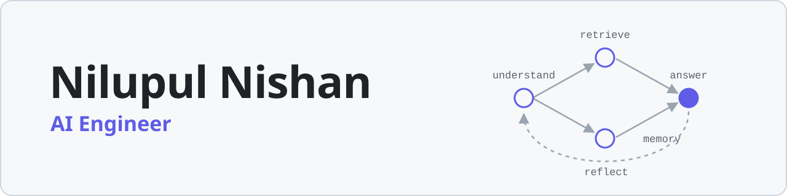

<picture>
  <source media="(prefers-color-scheme: dark)" srcset="assets/banner-dark.svg">
  <source media="(prefers-color-scheme: light)" srcset="assets/banner-light.svg">
  
</picture>

### AI Engineer building agentic systems, RAG pipelines, and the tools to ship them.

Colombo, Sri Lanka

[![LinkedIn][badge-linkedin]](https://www.linkedin.com/in/nilupulnishan/)

## About

- I build LLM applications: agent workflows in LangGraph, retrieval over long technical manuals, and document pipelines that read invoices and receipts.
- I also build tools for AI coding agents. [BAWA](https://github.com/NilupulNishan/bawa) and [BAAP](https://github.com/NilupulNishan/baap) are open plugins that take Claude Code or Codex from an idea to a working web or Android app.
- My roots are in deep learning and computer vision: Siamese networks for face verification, real-time face recognition, and a line-following robot that serves café tables.
- I studied at the University of Sri Jayewardenepura.

## Building now

<table>
<tr>
<td width="50%" valign="top">

**[BAWA: Build Any Web App](https://github.com/NilupulNishan/bawa)**

19 agent skills that take a web app from idea to a public URL. Point your agent at an app you like: it screenshots every page, writes user stories, then builds and tests one story per commit.

`React` `TypeScript` `Claude Code` `Codex`

</td>
<td width="50%" valign="top">

**[BAAP: Build Any Android aPp](https://github.com/NilupulNishan/baap)**

24 agent skills that take an Android app from idea to a signed release, with optional skills for enterprise and rugged devices.

`Kotlin` `Jetpack Compose` `Room` `Claude Code` `Codex`

</td>
</tr>
</table>

## Selected work

**Agents, RAG and document AI**

| Project | What it does |
| --- | --- |
| [VivoAssist](https://github.com/NilupulNishan/humanized-rag-workflow-langgraph-automobile) | Chat assistant for car owner manuals. A LangGraph agent works out what the driver is asking, keeps session memory, asks for clarification when needed, and answers in plain language. LangGraph · LlamaIndex · Azure OpenAI · ChromaDB · FastAPI |
| [Manual RAG engine](https://github.com/NilupulNishan/automobile-pdf-rag-llamaindex) | The retrieval layer under VivoAssist. Hierarchical chunking with parent summaries, and every answer links to the exact PDF page it came from. LlamaIndex · Azure OpenAI · ChromaDB · Streamlit |
| [Invoice review](https://github.com/NilupulNishan/e2e-invoice-review) | Classifies each document as an invoice or a receipt, extracts its fields with Azure Document Intelligence, and suggests a general ledger account. Pydantic AI · Azure Document Intelligence · Azure OpenAI |
| [Chart agent](https://github.com/NilupulNishan/agentic-chart-generator-langchain) | Reflection pattern: one model writes matplotlib code, a vision model critiques the rendered chart, and the code is rewritten. LangGraph · OpenAI · Anthropic |

**Machine learning, vision and robotics**

| Project | What it does |
| --- | --- |
| [Log classifier](https://github.com/NilupulNishan/nlp_log_classification) | Sorts system logs in three tiers: regex for known patterns, sentence embeddings with logistic regression, and an LLM for rare cases. Served as an API. Sentence Transformers · scikit-learn · Groq · FastAPI |
| [Face attendance](https://github.com/NilupulNishan/face-recognition-attendance-dlib-opencv) | Real-time attendance by face, using 128-dimension ResNet embeddings, with a Flask web view and SQLite logs. OpenCV · dlib · Flask · SQLite |
| [Face verification](https://github.com/NilupulNishan/Face_verification_app) | A Siamese network trained to verify a face against reference photos, wrapped in a webcam desktop app. TensorFlow · OpenCV · Kivy |
| [Waiter 117](https://github.com/NilupulNishan/Waiter_117-v1) | Line-following robot for a small café. It drives to a table, serves, and returns to the kitchen. C++ |

## Toolbox

**AI and LLM** 

![OpenAI][badge-openai]
![Azure AI][badge-azure]

**Machine learning and vision** 

**Backend and data** 

**Web** 

**Mobile and embedded** 

**Tools** 

---

Happy to collaborate on open-source AI projects. Say hi on <a href="https://www.linkedin.com/in/nilupulnishan/">LinkedIn</a> or by <a href="mailto:nilupulofficial2000@gmail.com">email</a>.

<!-- Logos that Simple Icons no longer ships, embedded from simple-icons 9.21.0 (CC0). -->
[badge-linkedin]: https://img.shields.io/badge/LinkedIn-0A66C2?style=flat-square&logo=data:image/svg%2Bxml;base64,PHN2ZyBmaWxsPSJ3aGl0ZSIgcm9sZT0iaW1nIiB2aWV3Qm94PSIwIDAgMjQgMjQiIHhtbG5zPSJodHRwOi8vd3d3LnczLm9yZy8yMDAwL3N2ZyI%2BPHRpdGxlPkxpbmtlZEluPC90aXRsZT48cGF0aCBkPSJNMjAuNDQ3IDIwLjQ1MmgtMy41NTR2LTUuNTY5YzAtMS4zMjgtLjAyNy0zLjAzNy0xLjg1Mi0zLjAzNy0xLjg1MyAwLTIuMTM2IDEuNDQ1LTIuMTM2IDIuOTM5djUuNjY3SDkuMzUxVjloMy40MTR2MS41NjFoLjA0NmMuNDc3LS45IDEuNjM3LTEuODUgMy4zNy0xLjg1IDMuNjAxIDAgNC4yNjcgMi4zNyA0LjI2NyA1LjQ1NXY2LjI4NnpNNS4zMzcgNy40MzNjLTEuMTQ0IDAtMi4wNjMtLjkyNi0yLjA2My0yLjA2NSAwLTEuMTM4LjkyLTIuMDYzIDIuMDYzLTIuMDYzIDEuMTQgMCAyLjA2NC45MjUgMi4wNjQgMi4wNjMgMCAxLjEzOS0uOTI1IDIuMDY1LTIuMDY0IDIuMDY1em0xLjc4MiAxMy4wMTlIMy41NTVWOWgzLjU2NHYxMS40NTJ6TTIyLjIyNSAwSDEuNzcxQy43OTIgMCAwIC43NzQgMCAxLjcyOXYyMC41NDJDMCAyMy4yMjcuNzkyIDI0IDEuNzcxIDI0aDIwLjQ1MUMyMy4yIDI0IDI0IDIzLjIyNyAyNCAyMi4yNzFWMS43MjlDMjQgLjc3NCAyMy4yIDAgMjIuMjIyIDBoLjAwM3oiLz48L3N2Zz4%3D
[badge-openai]: https://img.shields.io/badge/OpenAI-412991?style=flat-square&logo=data:image/svg%2Bxml;base64,PHN2ZyBmaWxsPSJ3aGl0ZSIgcm9sZT0iaW1nIiB2aWV3Qm94PSIwIDAgMjQgMjQiIHhtbG5zPSJodHRwOi8vd3d3LnczLm9yZy8yMDAwL3N2ZyI%2BPHRpdGxlPk9wZW5BSTwvdGl0bGU%2BPHBhdGggZD0iTTIyLjI4MTkgOS44MjExYTUuOTg0NyA1Ljk4NDcgMCAwIDAtLjUxNTctNC45MTA4IDYuMDQ2MiA2LjA0NjIgMCAwIDAtNi41MDk4LTIuOUE2LjA2NTEgNi4wNjUxIDAgMCAwIDQuOTgwNyA0LjE4MThhNS45ODQ3IDUuOTg0NyAwIDAgMC0zLjk5NzcgMi45IDYuMDQ2MiA2LjA0NjIgMCAwIDAgLjc0MjcgNy4wOTY2IDUuOTggNS45OCAwIDAgMCAuNTExIDQuOTEwNyA2LjA1MSA2LjA1MSAwIDAgMCA2LjUxNDYgMi45MDAxQTUuOTg0NyA1Ljk4NDcgMCAwIDAgMTMuMjU5OSAyNGE2LjA1NTcgNi4wNTU3IDAgMCAwIDUuNzcxOC00LjIwNTggNS45ODk0IDUuOTg5NCAwIDAgMCAzLjk5NzctMi45MDAxIDYuMDU1NyA2LjA1NTcgMCAwIDAtLjc0NzUtNy4wNzI5em0tOS4wMjIgMTIuNjA4MWE0LjQ3NTUgNC40NzU1IDAgMCAxLTIuODc2NC0xLjA0MDhsLjE0MTktLjA4MDQgNC43NzgzLTIuNzU4MmEuNzk0OC43OTQ4IDAgMCAwIC4zOTI3LS42ODEzdi02LjczNjlsMi4wMiAxLjE2ODZhLjA3MS4wNzEgMCAwIDEgLjAzOC4wNTJ2NS41ODI2YTQuNTA0IDQuNTA0IDAgMCAxLTQuNDk0NSA0LjQ5NDR6bS05LjY2MDctNC4xMjU0YTQuNDcwOCA0LjQ3MDggMCAwIDEtLjUzNDYtMy4wMTM3bC4xNDIuMDg1MiA0Ljc4MyAyLjc1ODJhLjc3MTIuNzcxMiAwIDAgMCAuNzgwNiAwbDUuODQyOC0zLjM2ODV2Mi4zMzI0YS4wODA0LjA4MDQgMCAwIDEtLjAzMzIuMDYxNUw5Ljc0IDE5Ljk1MDJhNC40OTkyIDQuNDk5MiAwIDAgMS02LjE0MDgtMS42NDY0ek0yLjM0MDggNy44OTU2YTQuNDg1IDQuNDg1IDAgMCAxIDIuMzY1NS0xLjk3MjhWMTEuNmEuNzY2NC43NjY0IDAgMCAwIC4zODc5LjY3NjVsNS44MTQ0IDMuMzU0My0yLjAyMDEgMS4xNjg1YS4wNzU3LjA3NTcgMCAwIDEtLjA3MSAwbC00LjgzMDMtMi43ODY1QTQuNTA0IDQuNTA0IDAgMCAxIDIuMzQwOCA3Ljg3MnptMTYuNTk2MyAzLjg1NThMMTMuMTAzOCA4LjM2NCAxNS4xMTkyIDcuMmEuMDc1Ny4wNzU3IDAgMCAxIC4wNzEgMGw0LjgzMDMgMi43OTEzYTQuNDk0NCA0LjQ5NDQgMCAwIDEtLjY3NjUgOC4xMDQydi01LjY3NzJhLjc5Ljc5IDAgMCAwLS40MDctLjY2N3ptMi4wMTA3LTMuMDIzMWwtLjE0Mi0uMDg1Mi00Ljc3MzUtMi43ODE4YS43NzU5Ljc3NTkgMCAwIDAtLjc4NTQgMEw5LjQwOSA5LjIyOTdWNi44OTc0YS4wNjYyLjA2NjIgMCAwIDEgLjAyODQtLjA2MTVsNC44MzAzLTIuNzg2NmE0LjQ5OTIgNC40OTkyIDAgMCAxIDYuNjgwMiA0LjY2ek04LjMwNjUgMTIuODYzbC0yLjAyLTEuMTYzOGEuMDgwNC4wODA0IDAgMCAxLS4wMzgtLjA1NjdWNi4wNzQyYTQuNDk5MiA0LjQ5OTIgMCAwIDEgNy4zNzU3LTMuNDUzN2wtLjE0Mi4wODA1TDguNzA0IDUuNDU5YS43OTQ4Ljc5NDggMCAwIDAtLjM5MjcuNjgxM3ptMS4wOTc2LTIuMzY1NGwyLjYwMi0xLjQ5OTggMi42MDY5IDEuNDk5OHYyLjk5OTRsLTIuNTk3NCAxLjQ5OTctMi42MDY3LTEuNDk5N1oiLz48L3N2Zz4%3D
[badge-azure]: https://img.shields.io/badge/Azure_AI-0078D4?style=flat-square&logo=data:image/svg%2Bxml;base64,PHN2ZyBmaWxsPSJ3aGl0ZSIgcm9sZT0iaW1nIiB2aWV3Qm94PSIwIDAgMjQgMjQiIHhtbG5zPSJodHRwOi8vd3d3LnczLm9yZy8yMDAwL3N2ZyI%2BPHRpdGxlPk1pY3Jvc29mdCBBenVyZTwvdGl0bGU%2BPHBhdGggZD0iTTIyLjM3OSAyMy4zNDNhMS42MiAxLjYyIDAgMCAwIDEuNTM2LTIuMTR2LjAwMkwxNy4zNSAxLjc2QTEuNjIgMS42MiAwIDAgMCAxNS44MTYuNjU3SDguMTg0QTEuNjIgMS42MiAwIDAgMCA2LjY1IDEuNzZMLjA4NiAyMS4yMDRhMS42MiAxLjYyIDAgMCAwIDEuNTM2IDIuMTM5aDQuNzQxYTEuNjIgMS42MiAwIDAgMCAxLjUzNS0xLjEwM2wuOTc3LTIuODkyIDQuOTQ3IDMuNjc1Yy4yOC4yMDguNjE4LjMyLjk2Ni4zMm0tMy4wODQtMTIuNTMxIDMuNjI0IDEwLjczOWEuNTQuNTQgMCAwIDEtLjUxLjcxM3YtLjAwMWgtLjAzYS41NC41NCAwIDAgMS0uMzIyLS4xMDZsLTkuMjg3LTYuOWg0Ljg1M202LjMxMyA3LjAwNmMuMTE2LS4zMjYuMTMtLjY5NC4wMDctMS4wNThMOS43OSAxLjc2YTEuNzIyIDEuNzIyIDAgMCAwLS4wMDctLjAyaDYuMDM0YS41NC41NCAwIDAgMSAuNTEyLjM2Nmw2LjU2MiAxOS40NDVhLjU0LjU0IDAgMCAxLS4zMzguNjg0Ii8%2BPC9zdmc%2B
